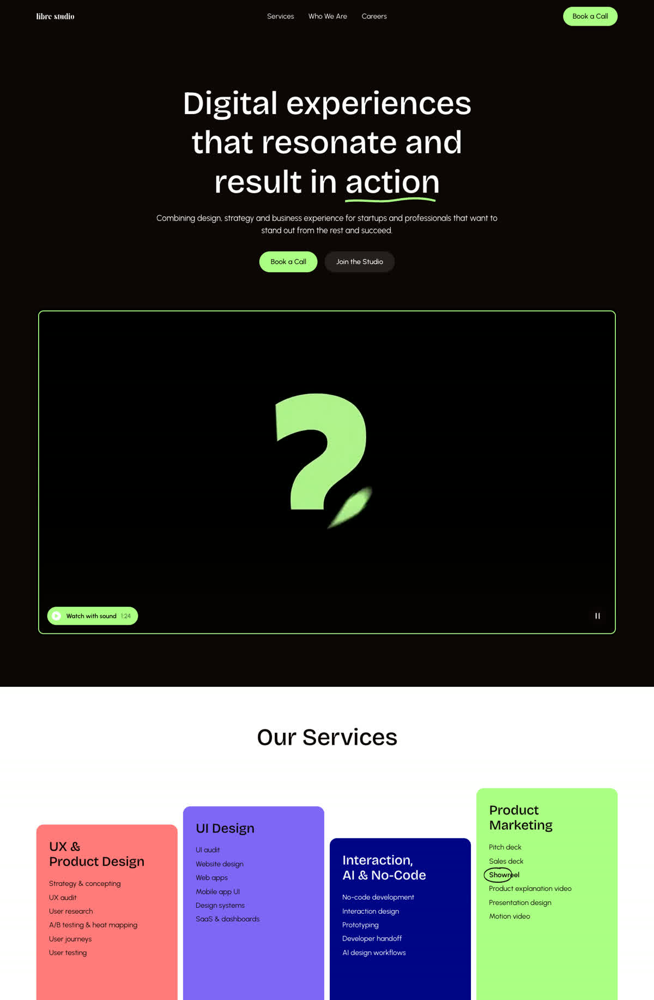
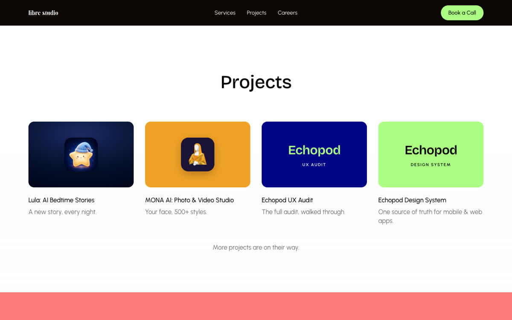

# librestudio.co

The website of [Libre Studio](https://librestudio.co), a remote product design studio for startups and B2B SaaS teams. Designed in Figma, built by hand in plain HTML, CSS and JavaScript with [Claude Code](https://claude.com/claude-code), with a human reviewing every step.



## What's in it

| Page | What it does |
|---|---|
| `/` | The showreel looping in the hero, four service columns, projects, process, FAQ |
| `/services/`, `/ui-ux-design/`, `/ux-audit/`, `/design-systems/`, `/design-engineering/`, `/motion-design/`, `/ai-design/` | Service pages, each written to answer one search question |
| `/work/…` | Case studies: Lula, MONA AI, Tales AI landing page, Echopod UX audit, this website |
| `/about/` | Who is behind the studio |
| `/careers/`, `/careers/apply/` | Open roles, the hiring map, the full role description and a button to the application form on ClickUp |
| `/privacy/`, `/kvkk-aday/`, `/acik-riza/`, `/kvkk-basvuru/`, `/cookies/`, `/cerez-politikasi/` | Candidate privacy notices in English and Turkish (KVKK), consent text, data subject request form, cookie notices |



## Design decisions

- **One design system, from Figma to code.** Colours, type scale, spacing and radius come straight from the Figma variables. Two typefaces only: Bricolage Grotesque for headings, Urbanist for text. Colour pairs were adjusted where the original failed WCAG AA contrast (for example, dark text on coral instead of white).
- **Motion with a job.** Every animation reveals, guides or emphasises: headlines rise word by word, one hand-drawn mark draws on per page, service columns rise like bars, the hiring steps draw as a transit-map line, the footer toucan blinks once. Ease-out entrances, 8 px distances, hard-edged wipes instead of crossfades, nothing bouncy.
- **Reduced motion respected.** With "reduce motion" on, everything lands at once and the showreel does not autoplay.
- **The showreel, made light.** A 145 MB master became a 2.9 MB silent loop for the hero (1.5 MB on phones) and a 17 MB version with sound that loads only when someone presses play. The loop pauses off screen and has a pause button.
- **Private by default.** Fonts and video are self-hosted and there is no analytics, so the site makes no third-party requests at all. The application form opens on ClickUp. A strict Content Security Policy allows only what each page needs.
- **Built to be found.** Structured data (JSON-LD) on every page, FAQ markup read from the visible text, `llms.txt` for AI crawlers, named crawler rules in `robots.txt`, hreflang between English and Turkish pages, a dated sitemap, and an IndexNow ping after every production deploy.
- **No framework, no dependencies.** A short Node script assembles the pages from templates. It fails the build on unrendered tags, on broken internal links and anchors, and on en or em dashes, a house style rule for client-facing copy.

## Run it locally

Needs Node 18 or later. Nothing to install.

```bash
node build.mjs     # src/ -> dist/
node preview.mjs   # http://localhost:4321, with the production headers
```

## Structure

```
build.mjs          builds dist/, writes _headers, _redirects, sitemap.xml, robots.txt
preview.mjs        local server that mirrors the production headers
netlify.toml       build settings for Netlify
netlify/plugins/   IndexNow ping after each production deploy
src/pages/         one .tpl per page
src/partials/      head, navigation, footer
src/assets/        css, js, fonts, images, video
```

## Credits

Design and direction: [Başak Feyzioğlu](https://www.linkedin.com/in/basakfeyzioglu/). Built with Claude Code.

Copy, brand assets, the showreel and project images are © Libre Studio. All rights reserved.
